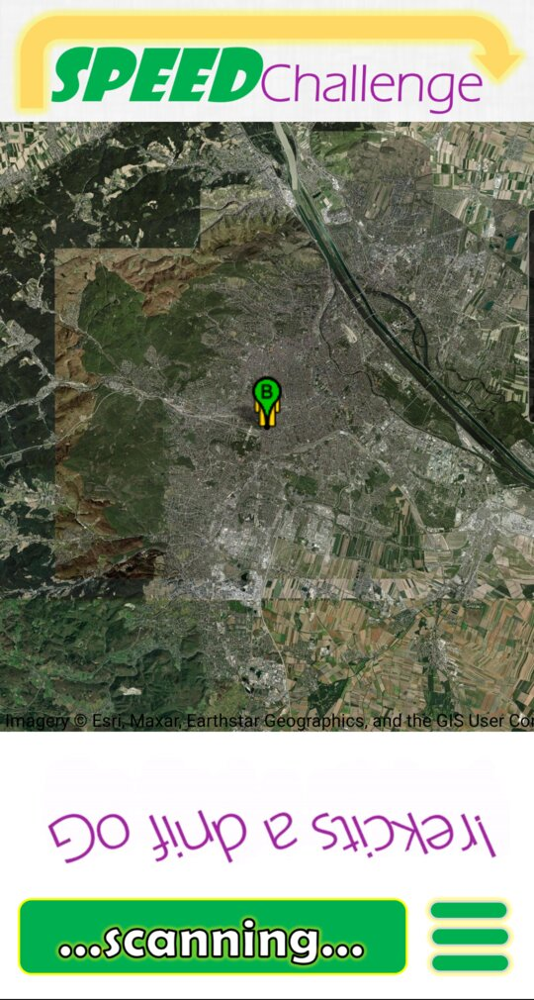

# A2B

A2B is an Android app for NFC-based time trials: place two NFC tags in the real world — START (A) and FINISH (B) — and race the clock between them. Scan the start tag, run (or ride, or roll) to the finish tag, scan it, and see how you rank.

> *"It's not a sport, it's not a competition, it's an ancient urge... the quest to find THE PATH OF SHORTEST DURATION!"*

<p align="center"></p>

The fun part: **the tags are the database.** The finish tag itself carries the track's top-three leaderboard, so the high scores live out there in the world, glued to a lamppost. A small online directory ([Supabase](https://supabase.com)) only lists where the tracks are, so everyone can find them on the map.

## Features

- **Create tracks**: pin start and finish markers on a satellite map, then write the track (name, description, distance, altitude difference measured with the barometer) onto two physical NFC tags.
- **Race**: scan the start tag to see the track, scan it again to start the clock, scan the finish tag to stop it.
- **On-tag leaderboard**: your time, nickname, and date are written straight onto the finish tag when you make the top three.
- **Track map**: on start, the map shows every track published online. New tracks are published automatically (or on the next start, if you were offline).
- **My Tracks / My Records**: the app remembers every track it has seen — the ones you created and the ones where you currently hold a top-three place.

## How it works

Each track is a pair of NDEF tags sharing a random `stamp`:

| Tag | Contents |
|---|---|
| START | stamp, track name, description, horizontal/vertical distance, start & finish coordinates |
| FINISH | −stamp, top-three leaderboard (time, date, nickname ×3) |

The sign of the stamp tells the two tag types apart; the matching absolute value proves you finished the track you started. Everything is packed as compact binary NDEF records so a track fits on a cheap NTAG213.

The online directory is a single Supabase table, `tracks` (schema and access rules in [`supabase/schema.sql`](supabase/schema.sql)): anyone can read and add tracks, nobody can change or delete them through the API. Leaderboards are not stored online.

## Map

The satellite map uses [osmdroid](https://github.com/osmdroid/osmdroid) with Esri World Imagery tiles: no API key, account or billing required. Keep the imagery attribution visible on the map.

## Requirements

- Android 6.0 (API 23) or newer with **NFC support**
- Writable NFC tags (e.g. NTAG213/215/216) for creating tracks

## Building

1. Clone the repository.
2. Optional, for the online track map: create a [Supabase](https://supabase.com) project, run [`supabase/schema.sql`](supabase/schema.sql) in its SQL editor, and put the project's values (from *Settings → API Keys*) in `~/.gradle/gradle.properties` (do **not** commit them). Without them the app just works offline with the tracks it knows:

   ```properties
   SUPABASE_URL=https://your-project.supabase.co
   SUPABASE_PUBLISHABLE_KEY=sb_publishable_...
   ```

3. Build and install:

   ```sh
   ./gradlew assembleDebug
   adb install -r app/build/outputs/apk/debug/app-debug.apk
   ```

## Creating a new track

1. Choose "Set new track" in the menu.
2. Touch and hold marker **B** on the map, then drag it to the position of the FINISH tag ("update marker" moves it to your current position).
3. Scan the FINISH tag.
4. Touch and hold marker **A**, then drag it to the position of the START tag.
5. Fill in the track name and a short message/description/greeting/poem.
6. Scan the START tag and wait for the SUCCESS!

## License

This project is licensed under the [MIT License](LICENSE).
